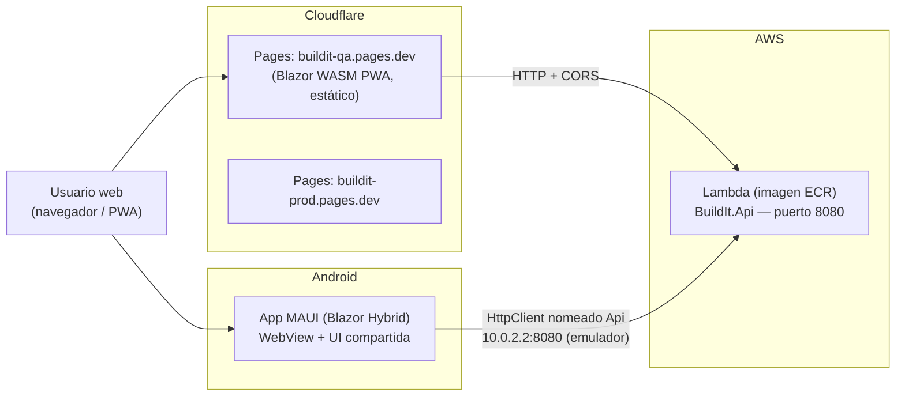
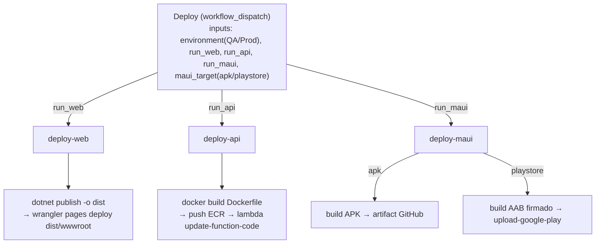

# Arquitectura y Deploy — BuildIt

> Cómo funcionan los proyectos en conjunto, dónde corre cada componente y cómo se despliega.
> Para el flujo de desarrollo local y matriz de tests, ver [DEVELOPMENT.md](DEVELOPMENT.md).

## 1. Panorama de componentes



- **Un solo frontend lógico**: los componentes Razor viven en `BuildIt.SharedUI` (RCL) y los consumen tanto la Web (Blazor WASM) como la app MAUI (Blazor Hybrid).
- **Un solo backend**: `BuildIt.Api` consumido por HTTP desde Web y MAUI. **Ningún proyecto referencia la Api** (ni Web ni MAUI ni SharedUI): solo contratos vía `BuildIt.Shared`.
- La Web es **estática** (sin servidor ASP.NET Core para el frontend): se puede servir de CDN, S3 o Pages.

## 2. Los proyectos y su rol

| Proyecto | SDK | Rol | Comparte |
|---|---|---|---|
| `BuildIt.Shared` | .NET 10 | DTOs, interfaces, modelos (contratos del dominio) | Referenciado por Api, Web, Maui, SharedUI |
| `BuildIt.SharedUI` | Razor Class Library | **Componentes y páginas compartidas**: `App.razor` (Router), `Pages/` (Index, Counter, FetchData), `Shared/` (MainLayout, NavMenu, SurveyPrompt), estilos (`css/app.css`, bootstrap local) | Referenciado por Web y Maui |
| `BuildIt.Api` | ASP.NET Core (MVC) | Backend REST: controladores, EF Core + MySQL, OpenIddict (auth), `/openapi/v1.json` | Nadie lo referencia |
| `BuildIt.Web` | Blazor WebAssembly (PWA) | Host del frontend web: aloja `SharedUI.App`, registra `HttpClient` hacia la Api | Referencia SharedUI |
| `BuildIt.Maui` | .NET MAUI (Blazor Hybrid) | App móvil Android (TFMs ios/maccatalyst/windows declarados): `MainPage.xaml` aloja `SharedUI.App` en `BlazorWebView` | Referencia SharedUI |
| `tests/*` | xUnit v2 | Unit (Shared, Api, SharedUI-bUnit, Web) + Integración (Testcontainers MySQL) | — |

### Cómo comparten la UI (Web + MAUI)

- `App.razor` de la RCL contiene el `<Router>`; cada host lo monta como componente raíz:
  - **Web**: `builder.RootComponents.Add<BuildIt.SharedUI.App>("#app")` en `Program.cs`.
  - **MAUI**: `<b:RootComponent Selector="#app" ComponentType="{x:Type sharedUI:App}" />` en `MainPage.xaml`.
- El HttpClient lo registra **cada host** con su BaseAddress propia:
  - Web: `Api:BaseUrl` de `wwwroot/appsettings.json` (ej. `http://localhost:8080`).
  - MAUI: `appsettings.json` embebido → `Api:BaseUrl` (`http://10.0.2.2:8080` desde el emulador Android; IP LAN para dispositivo físico).
- Los assets estáticos de la RCL se sirven bajo `_content/BuildIt.SharedUI/` (web) o los empaqueta el APK (MAUI).

### Detalles no obvios del frontend (lecciones de deploy)

1. **Fingerprint placeholder**: en .NET 9/10 el publish renombra TODO `_framework/` con hash de contenido (`blazor.webassembly.w3qd1tpl0e.js`) y elimina el archivo sin hash. El `index.html` debe referenciar el script con el placeholder `#[.{fingerprint}]`, que el SDK reemplaza al publicar. **No escribir ese literal dentro de comentarios HTML**: dos ocurrencias del patrón rompen el reemplazo y la app queda en "Cargando...".
2. **Bundle de CSS aislado**: `BuildIt.SharedUI.<hash>.bundle.scp.css` se genera con hash y el SDK no reescribe la referencia en el host; el workflow de deploy la reescribe post-publish.
3. **`_redirects`**: sin catch-all `/* /index.html 200` (los rewrites 200 tienen precedencia sobre assets estáticos y rompen `_framework/`). Solo rutas explícitas por página. `404.html` presente desactiva el fallback SPA automático de Pages.

## 3. Dónde corre cada cosa

| Componente | Entorno QA | Entorno Prod |
|---|---|---|
| **Web (PWA)** | Cloudflare Pages: `buildit-qa.pages.dev` (+ alias por rama: `<branch>.buildit-qa.pages.dev`) | Cloudflare Pages: `buildit-prod.pages.dev` |
| **Api** | Lambda `buildit-api-qa` (imagen de ECR `buildit-api`) | Lambda `buildit-api-prod` |
| **BD MySQL** | Imagen propia `build-it-db` (ver `sync-db.yml`) — Testcontainers en CI; gestionar instancia para ambientes | Igual, datos separados |
| **MAUI Android** | APK artifact de GitHub Actions | Play Store track `production` (o APK según `target`) |
| **CI (build/test)** | GitHub Actions ubuntu-latest con Docker (Testcontainers) | igual |

- La Api escucha en `0.0.0.0:8080` (puerto que espera Lambda) y usa `ConnectionStrings__DefaultConnection` por variable de entorno.
- La Web NO tiene servidor: es un bucket de archivos estáticos. La Api debe permitir CORS desde el origen del PWA (política `BlazorWasm` en `Program.cs`).

## 4. Deploy: `deploy.yml` (workflow_dispatch)

Un solo workflow con tres acciones compuestas y toggles para correr cada una o no:



### `deploy-web` (`.github/actions/deploy-web/`)

1. `dotnet publish src/BuildIt.Web -c Release -o ./dist` (los estáticos quedan en `dist/wwwroot`).
2. Reescribe el link del bundle de CSS aislado con su hash post-publish.
3. Crea el proyecto Pages si no existe (`pages project create`, tolerado si ya existe).
4. `wrangler@4 pages deploy dist/wwwroot --project-name buildit-qa|buildit-prod`.
   - **Wrangler 4 obligatorio**: el wrangler-action cae a 3.90.0 por defecto y esa versión usa un pipeline viejo de Pages que genera snapshots sin assets.
   - Cada rama genera un alias `<branch>.buildit-qa.pages.dev`; el dominio raíz sirve la production branch del proyecto (`main`).

### `deploy-api` (`.github/actions/deploy-api/`)

1. `docker build -f src/BuildIt.Api/Dockerfile .` (contexto = raíz del repo).
2. Push a ECR con dos tags: `<image_tag>` y `latest`.
3. `aws lambda update-function-code --function-name buildit-api-qa|prod --image-uri ...`.
4. Autenticación por **OIDC** (rol IAM asumido, sin Access Keys).

### `deploy-maui` (`.github/actions/deploy-maui/`)

Input `target`:

- **`apk`** (default): build APK Release → artifact de GitHub (`buildit-maui-apk-<env>`, 30 días). Iteración rápida sin review.
- **`playstore`**: build AAB (`-p:AndroidPackageFormat=aab`) firmado con keystore de release (decodificado de secret base64) → publicación a Google Play con `r0adkll/upload-google-play`:
  - QA → track `internal`; Prod → track `production` (override con `maui_target`+`play_track`).
  - Google Play rechaza AABs sin firma de release → valida inputs y falla temprano si falta algo.
- **Vía alternativa de actualización de UI (pendiente de implementar)**: MAUI es Blazor Hybrid, por lo que cambios de UI (Razor/CSS/JS) pueden servirse remotamente (cache-first) sin nueva APK; solo cambios nativos requieren nueva versión.

## 5. Secretos requeridos (GitHub → Settings → Secrets and variables → Actions)

| Secret | Lo usa | Para qué |
|---|---|---|
| `CLOUDFLARE_API_TOKEN` | deploy-web | Token con permisos Account > Cloudflare Pages > Edit + User > User Details > Read |
| `CLOUDFLARE_ACCOUNT_ID` | deploy-web | Account ID (evita que wrangler llame `/memberships`) |
| `AWS_ECR_REGISTRY` | deploy-api | URL del registry ECR |
| `AWS_IAM_ROLE_ARN` | deploy-api | Rol para OIDC (sin Access Keys) |
| `AWS_REGION` | deploy-api | Región de AWS |
| `PLAY_STORE_SERVICE_ACCOUNT_JSON` | deploy-maui (playstore) | SA de Play Console con rol Release Manager |
| `MAUI_KEYSTORE_BASE64` | deploy-maui (playstore) | Keystore de release en base64 |
| `MAUI_KEYSTORE_PASSWORD` / `MAUI_KEYSTORE_ALIAS` | deploy-maui (playstore) | Firma del AAB |

## 6. Ejecución

```bash
# Solo Web a QA
gh workflow run deploy.yml --ref <branch> -f environment=QA -f run_web=true

# Web + API a Prod
gh workflow run deploy.yml --ref <branch> -f environment=Prod -f run_web=true -f run_api=true

# MAUI a Play Store
gh workflow run deploy.yml --ref <branch> -f run_maui=true -f maui_target=playstore -f environment=Prod
```

Los workflows deben existir en la rama (`--ref`) o en `production` para aparecer en la UI de Actions.

## 7. CI (`ci.yml`)

En PR/push a `production`:
1. Build de los 8 proyectos del slnf (sin Maui) con `TreatWarningsAsErrors`.
2. `dotnet format BuildIt.slnf --verify-no-changes`.
3. `dotnet test` con cobertura (unit + integración con Docker en el runner; el pre-push local filtra `Category!=Integration`).
4. Job `maui-android` **solo en push a `production`**: workload maui-android + build `-p:AndroidOnly=true`.

## 8. Pendientes conocidos del deploy

- [ ] Resiliencia HTTP en Web WASM (`AddStandardResilienceHandler` requiere paquete `Microsoft.Extensions.Http` compatible WASM — hoy HttpClient directo).
- [ ] Pipeline de live-update de UI para MAUI (cache-first).
- [ ] Instancia MySQL gestionada para QA/Prod (hoy solo imagen de Testcontainers en CI).
- [ ] Observabilidad (OpenTelemetry) — decisión de backend pendiente.
